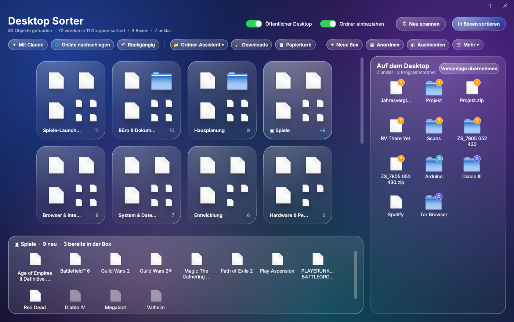

# Desktop Sorter

Sortiert die Symbole auf dem Windows-Desktop thematisch in Gruppenordner – nach dem Vorbild der iOS-App-Mediathek (Spiele, Kommunikation, Entwicklung, …). Oberfläche im Liquid-Glass-Stil mit echtem Windows-Acrylic-Hintergrund.



*Testansicht mit Platzhalter-Symbolen. Unter Windows erscheinen die echten Programmsymbole und das unscharf durchscheinende Desktop-Hintergrundbild.*

## Installation

Voraussetzung: Windows 10/11, Python ≥ 3.9.

```powershell
py -m pip install -r requirements.txt
```

Danach `DesktopSorter.pyw` per Doppelklick starten (oder `py DesktopSorter.pyw`).
Die Datei **nicht auf den Desktop** legen, sonst sortiert sie sich selbst mit ein.

## Funktionsweise

Jedes Objekt durchläuft diese Stufen; die erste, die greift, entscheidet:

1. **Deine Entscheidungen** aus früheren Läufen (`entscheidungen.json`)
2. **Eigene Regeln** aus `regeln.toml` – z. B. Projektthemen wie „Hausplanung“
3. **App-Wissensbasis** – Name und Ziel-EXE der Verknüpfung
4. **Spiele-Erkennung** – Ziel liegt in Steam-, Epic-, EA-, Ubisoft-Bibliotheken oder ist ein `steam://`-Link
5. **Stichwörter** im Dateinamen (Rechnung, Bestellung, …)
6. **Dateityp** – nur als Vorschlag; solche Objekte gelten als *unklar*
7. **Optional Claude** – ordnet Unklares semantisch zu und darf eigene Themen bilden

Erfasst werden beide Desktop-Quellen, die Windows gemeinsam anzeigt: der eigene Desktop (auch OneDrive-umgeleitet) und der öffentliche Desktop (`C:\Users\Public\Desktop`).

## Bedienung

| Aktion | So geht's |
|---|---|
| Inhalt einer Gruppe | Glaskarte anklicken |
| Unklares zuordnen (orange **?**) | auf eine Karte oder auf **„+ Neue Gruppe“** ziehen · Doppelklick übernimmt den Vorschlag |
| Rechtsklick auf Objekt | Vorschlag übernehmen · Verschieben nach · Neue Gruppe · Auf Desktop lassen · Öffnen · Als Regel merken |
| Rechtsklick auf Karte | Umbenennen · Auflösen |
| **Sortieren** | verschiebt erst nach Bestätigung |
| **Rückgängig** | stellt den letzten Lauf vollständig wieder her |
| **Mit Claude sortieren** | fragt einmalig nach dem `ANTHROPIC_API_KEY` (nur für die Sitzung) |

## Dateien

| Datei | Zweck |
|---|---|
| `DesktopSorter.pyw` | die komplette Anwendung |
| `regeln.toml` | eigene Themen; wird beim ersten Start angelegt und ist frei editierbar |
| `entscheidungen.json` | deine Zuordnungen und gelernten Stichwörter (persönlich, nicht im Repo) |
| `%USERPROFILE%\.desktop_sorter\` | Journal für „Rückgängig“ |

Beispiel für `regeln.toml`:

```toml
[regeln]
"Hausplanung" = ["obergeschoss", "grundriss", "loopcad", "sweet home"]
"Labor"       = ["benchling", "snapgene", "\\.ab1$"]
```

## Datenschutz

Ohne Claude läuft alles lokal. Mit **Mit Claude sortieren** werden nur Anzeigename, Typ und Ziel der unklaren Objekte gesendet – der Benutzerpfad wird dabei durch `%USERPROFILE%` ersetzt, Dateiinhalte werden nie übertragen.

## Fehlerbehebung

- **Schwarzer statt durchsichtiger Hintergrund:** In `DesktopSorter.pyw` `ACRYLIC = False` setzen.
- **Mehr oder weniger Transparenz:** `ACRYLIC_TINT = "12141C55"` – die letzten zwei Stellen sind die Deckkraft.
- **Verknüpfungen vom öffentlichen Desktop lassen sich nicht verschieben:** als Administrator starten oder den Schalter „Öffentlicher Desktop“ ausschalten.
- **Doppelklick öffnet einen Editor:** Rechtsklick → Öffnen mit → `pythonw.exe` → „Immer diese App verwenden“.
