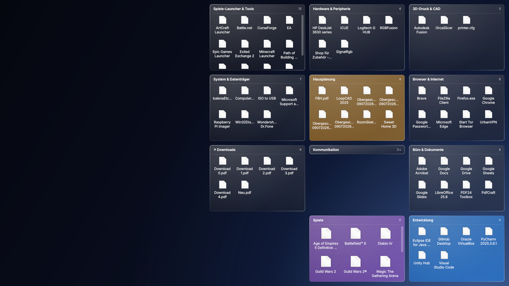
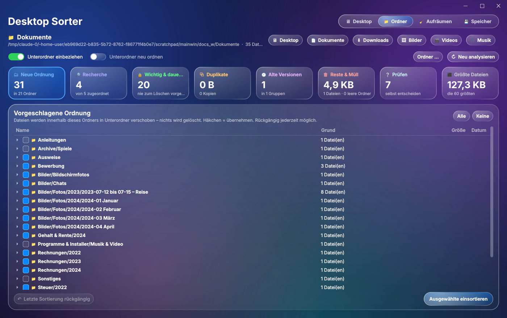
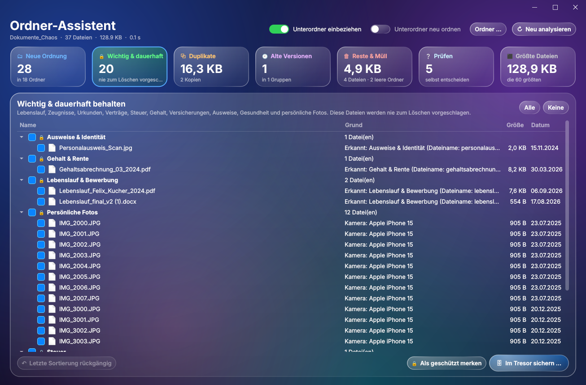
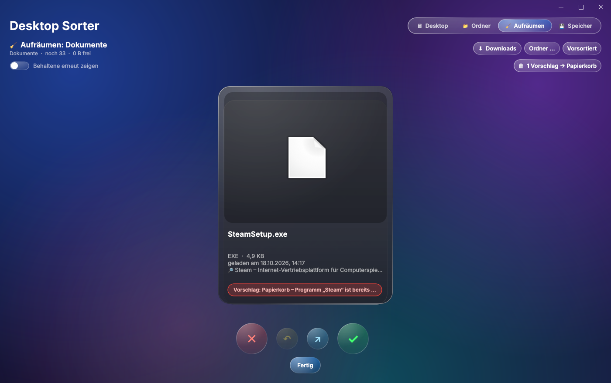

# Desktop Sorter

Sortiert die Symbole auf dem Windows-Desktop thematisch in **Glas-Boxen direkt auf dem Desktop** – nach dem Prinzip von Stardock Fences, gruppiert wie die iOS-App-Mediathek (Spiele, Kommunikation, Entwicklung, …). Jede Box zeigt alle ihre Programme; ein Klick startet sie.




*Testansichten mit Platzhalter-Symbolen. Unter Windows erscheinen die echten Programmsymbole, und die Boxen zeigen dein Hintergrundbild unscharf durch (Acrylic).*

## Installation

Voraussetzung: Windows 10/11, Python ≥ 3.9.

```powershell
py -m pip install -r requirements.txt
```

Danach `DesktopSorter.pyw` per Doppelklick starten (oder `py DesktopSorter.pyw`).
Die Datei **nicht auf den Desktop** legen, sonst sortiert sie sich selbst mit ein.

## Ablauf

1. **Zuordnen** im Hauptfenster: Gruppen erscheinen als Glaskarten, Unklares (orange **?**) ordnest du per Drag & Drop oder Rechtsklick zu. Deine **bestehenden Boxen** (▣) stehen immer als Karte bereit – auch leere –, sodass du jederzeit etwas hineinziehen kannst.
2. **In Boxen sortieren**: Verknüpfungen, Dateien und Ordner wandern in `%USERPROFILE%\DesktopSorter Boxen\<Gruppe>`, und für jede Gruppe erscheint eine Glas-Box auf dem Desktop.
3. Die App läuft danach im **Infobereich** (Tray) weiter und hält die Boxen auf dem Desktop. Sie trägt sich beim Start **automatisch in den Windows-Autostart** ein (startet dann nur Boxen + Tray, ohne Hauptfenster). Abschalten: *☰ Mehr* bzw. Tray → *Einstellungen* → *Mit Windows starten*.

## Das Hauptfenster

Alle Funktionen sind von hier aus erreichbar:

| Bereich | Knöpfe |
|---|---|
| Kopfzeile | *Öffentlicher Desktop* · *Ordner einbeziehen* · **↻ Neu scannen** · **In Boxen sortieren** |
| Sortieren | **✦ Mit Claude** (Unklares per KI) · **🌐 Online nachschlagen** · **↶ Rückgängig** |
| Aufräumen | **📁 Ordner-Assistent ▾** (Dokumente, Downloads, Bilder, Desktop, Videos, anderer Ordner) · **🧹 Downloads** (Tinder-Stil) · **🗑 Papierkorb** |
| Boxen | **+ Neue Box** · **▦ Anordnen** · **◐ Aus-/Einblenden** · **☰ Mehr ▾** (Ordner-Boxen, Layouts, Einstellungen, regeln.toml, Beenden) |

| Karte / Liste | Bedeutung |
|---|---|
| **▣ Name +3** | bestehende Box, 3 neue Objekte kommen hinzu (ohne Neues: Anzahl in der Box, Symbole blass) |
| **+ Neue Gruppe** | hierher ziehen → Name eingeben |
| **🗑 Papierkorb** | hierher ziehen → nach Rückfrage in den Windows-Papierkorb (auch: Rechtsklick → *In den Papierkorb*, Taste **Entf**) |
| orange **?** | unklar – Vorschlag per Doppelklick übernehmen |
| lila/türkis **⚙** | Programm- bzw. Projektordner – bleibt liegen |

Ein Klick auf eine Box-Karte zeigt unten ihren Inhalt: neue Objekte zum Verschieben, darunter blass, was schon in der Box liegt (Doppelklick öffnet, Rechtsklick: *Zurück auf den Desktop*, *In den Papierkorb*). Rechtsklick auf eine Box-Karte: *Box-Ordner öffnen*, *Box umbenennen*, *Box auflösen*.

**Unterordner** werden mit einsortiert (*Ordner einbeziehen*, Standard an) – aber nur, wenn es Inhaltsordner sind (Fotos, Dokumente, Musik …). **Programm-, Spiel- und Projektordner bleiben liegen**, damit sie weiter funktionieren:

| Erkannt als | Woran |
|---|---|
| Programm / Spiel ⚙ | in Windows als installiertes Programm eingetragen (Registry `InstallLocation`) · `.exe`/`.dll`/`.jar`/`.pak` in den ersten zwei Ebenen · Spuren wie `.build.info` (Blizzard), `steam_appid.txt`, `UnityPlayer.dll`, `unins000.exe` |
| Projekt ⚙ | `.git`, `.sln`/`.csproj`/`.vcxproj`, `CMakeLists.txt`, `package.json` + Code … – auch eine Ebene tiefer (z. B. *Visual Studio/Projects/…*) · Arduino-Sketche (`.ino`) |
| Inhalt | ≥ 60 % einer Dateiart → passende Gruppe (z. B. Fotos → *Bilder & Grafik*); Ordnernamen wie *Bewerbung* → *Büro & Dokumente*, *Steuer 2023* → *Finanzen* |

Wer einen Programmordner trotzdem einsortieren oder löschen will, wird vorher gewarnt.

**Online nachschlagen** fragt für unklare Ordner und Verknüpfungen bei **Wikidata/Wikipedia** nach, was hinter dem Namen steckt („Diablo III → Computerspiel → *Spiele*“, „Arduino → Mikrocontroller-Plattform → *Entwicklung*“). Ordner, die online als Software gelten, werden zusätzlich tief nach Programmdateien durchsucht – findet sich eine `.exe`, bleibt der Ordner liegen. Beim ersten Mal wählst du *Immer automatisch* (nach jedem Scan) oder *Nur auf Knopfdruck*; umstellbar unter *☰ Mehr*. Google bietet für solche Abfragen keine freie Schnittstelle; Wikidata ist die offene Wissensdatenbank hinter vielen Suchmaschinen-Infoboxen.

## Die Boxen

| Aktion | So geht's |
|---|---|
| Programm starten | **ein Klick** auf das Symbol |
| Box verschieben | Titelleiste ziehen |
| Größe ändern | rechte untere Ecke ziehen |
| Ein-/Ausklappen | Doppelklick auf die Titelleiste |
| Zwischen Boxen verschieben | Symbol in eine andere Box ziehen · Rechtsklick → *Verschieben in* |
| Zurück auf den Desktop | Symbol auf den Desktop ziehen · Rechtsklick → *Zurück auf den Desktop* |
| Neues in eine Box legen | Datei vom Desktop/Explorer auf die Box ziehen |
| Rechtsklick auf Titelleiste | Darstellung · Umbenennen · Ordner öffnen · Neue Box · Neue Ordner-Box · Auflösen |

Position, Größe, Einklapp-Zustand und Darstellung jeder Box werden gespeichert. Die Boxen spiegeln den Inhalt ihrer Ordner live – was du im Explorer in `DesktopSorter Boxen\<Gruppe>` legst, erscheint sofort in der Box.

## Fences-Funktionen

| Funktion | Beschreibung |
|---|---|
| **Quick-Hide** | Doppelklick auf eine freie Desktopfläche blendet alle Boxen aus und wieder ein (mit Überblendung) |
| **Win + D-fest** | Boxen sind an den Desktop geheftet und bleiben bei „Desktop anzeigen“ sichtbar |
| **Automatisch einsortieren** | Neue Verknüpfungen auf dem Desktop (z. B. von Installern) landen nach 2 s in der passenden Box; Hinweis im Infobereich. Was du selbst aus einer Box auf den Desktop ziehst, bleibt dort |
| **Ordner-Boxen** | Eine Box zeigt einen beliebigen Ordner live an (z. B. Downloads); erkennbar am ↗ im Titel |
| **Aufklappen beim Überfahren** | Eingeklappte Boxen öffnen sich, solange die Maus darüber ist – auch beim Hineinziehen |
| **Magnetisches Ausrichten** | Boxen rasten an Bildschirmrändern und aneinander ein (Abstand 10 px) |
| **Darstellung je Box** | Farbe (Glas, Blau, Lila, Grün, Orange, Rot, Grau) · Deckkraft · Symbolgröße · Sortierung (Name, Typ, Neueste) |
| **Layouts** | Anordnung aller Boxen speichern und wiederherstellen · *Boxen neu anordnen* |
| **Mehrere Bildschirme** | Boxen außerhalb des sichtbaren Bereichs (Auflösung geändert, Monitor abgesteckt) werden zurückgeholt |

Alle Schalter liegen im Tray-Menü unter **Einstellungen**, Layouts unter **Layouts**.

## Ordner-Assistent – jeden Ordner aufräumen & sortieren

Rechtsklick auf einen Ordner im Explorer → **Mit Desktop Sorter aufräumen** (unter Windows 11 in *Weitere Optionen anzeigen*), oder Tray → **📁 Ordner-Assistent** → Dokumente / Downloads / Bilder / Desktop / Videos / *Anderer Ordner …*. Der Assistent analysiert alle Dateien – auch den **Inhalt** von PDFs, Word-, Excel-, PowerPoint-, OpenOffice- und Textdateien sowie die **EXIF-Daten** von Fotos – und schlägt vor, was wichtig ist, was weg kann und wohin der Rest gehört. Die Erkennung ist **zweisprachig (Deutsch + Englisch)**.



| Bereich | Was du bekommst |
|---|---|
| 🗂 **Neue Ordnung** | Zielordner wie `Dokumente/Bewerbung`, `Dokumente/Steuer/2022`, `Dokumente/Rechnungen/2024`, `Bilder/Fotos/2023/2023-07-12 bis 07-15 – Reise`. Nur Verschieben innerhalb des Ordners, mit **Rückgängig** (Journal) |
| 🔒 **Wichtig & dauerhaft** | Lebenslauf/CV, Anschreiben, Zeugnisse, Urkunden, Ausweise, Verträge, Versicherungen, Steuer, Gehalt & Rente, Gesundheit, Wohnen, **persönliche Fotos & Videos** – werden **nie** zum Löschen vorgeschlagen. *Als geschützt merken* schützt sie auch in allen anderen Funktionen. **🗄 Im Tresor sichern**: inkrementelle Kopie mit Prüfsummen-Kontrolle z. B. nach OneDrive oder auf eine externe Festplatte |
| ⧉ **Duplikate** | Byte-identische Kopien (Prüfsumme). Das Original bleibt immer – bevorzugt die sinnvoll benannte, wichtige Fassung (`Personalausweis.jpg` statt `IMG_4567.JPG`) |
| 🕘 **Alte Versionen** | `Lebenslauf_final.docx`, `…_final_v2 (1).docx`, „Kopie“, „neu“, „Entwurf“ … – die neueste bleibt, Zahlen/Daten (`Rechnung_1234` vs. `_1235`) gelten nicht als Versionen |
| 🗑 **Reste & Müll** | Office-/LibreOffice-Sperrdateien, Temporäres, abgebrochene Downloads, leere Dateien und Ordner, Installer **bereits installierter** Programme (Abgleich mit der Windows-Programmliste) |
| ❔ **Prüfen** | Unklares – am schnellsten per **Einzeln durchwischen** |
| ⬛ **Größte Dateien** | die 60 größten Platzfresser |

Fotos: Kamera- und Handy-Fotos (EXIF-Hersteller/-Modell, `IMG_…`, `PXL_…`, `DSC…`) gelten als persönlich und werden nach **Ereignissen** gruppiert; Serien weit weg vom Wohnort (GPS) bekommen „– Reise“. Bildschirmfotos und WhatsApp-/Telegram-/Signal-Bilder werden getrennt erkannt.



**Sicherheit:**
- Gelöscht wird nichts ohne Bestätigung, und nur in den **Papierkorb**. Auf Laufwerken ohne Papierkorb (USB-Stick, Netzlaufwerk) wird gar nicht gelöscht.
- Wichtige Dateien, Projektordner (`.git`, Code-Projekte), Programm-, System- und AppData-Ordner, Junctions/Links und **OneDrive-Dateien „nur online“** werden nie angefasst. Letztere werden auch nie gelesen, damit kein Download ausgelöst wird.
- Dateien, die sich seit der Analyse geändert haben, werden übersprungen.
- Ein Duplikat wird nur gelöscht, wenn sein Original unverändert existiert.
- Verschoben wird standardmäßig nur, was lose im gewählten Ordner liegt. *Unterordner neu ordnen* ist optional, und eigene Unterordner bleiben dabei erhalten.

Rechtsklick auf eine Datei im Assistenten: Öffnen · Im Explorer zeigen · Kategorie ändern · Schützen · Nicht anfassen.

## Downloads aufräumen

Tray → **🧹 Downloads aufräumen …** (oder bei einer Ordner-Box: Rechtsklick → *Ordner aufräumen …*). Jede Datei erscheint als Karte mit Vorschau – Bild, erste PDF-Seite, Textanfang oder Programmsymbol – samt Größe, Datum und Herkunft („von github.com“, aus dem Windows-Download-Vermerk).

**Vorsortiert:** Die Analyse des Ordner-Assistenten läuft im Hintergrund mit. Löschvorschläge (Duplikate, installierte Installer, Reste) kommen zuerst, Wichtiges zuletzt; jede Karte zeigt einen farbigen **Grund** („Vorschlag: Papierkorb – Exakte Kopie von foto.jpg“, „🔒 Wichtig – Lebenslauf & Bewerbung“). **Alle N Vorschläge → Papierkorb** markiert sie auf einmal (einzeln rückgängig). Wer etwas Wichtiges oder die letzte Kopie einer Datei nach links wischt, wird gefragt.



| Aktion | Maus | Tastatur |
|---|---|---|
| In den Papierkorb | nach **links** wischen · ✕ | ← · Entf |
| Behalten | nach **rechts** wischen · ✓ | → · Leertaste |
| Öffnen / ansehen | ↗ | Enter · ↑ |
| Rückgängig | ↶ | Strg + Z · Rücktaste |

- Gelöscht wird **erst bei „Fertig“** (oder beim Schließen) und nur in den **Papierkorb** – alles bleibt wiederherstellbar; bis dahin ist jede Entscheidung rückgängig zu machen.
- Behaltene Dateien werden beim nächsten Mal nicht erneut gezeigt (außer sie ändern sich). Schalter *Behaltene erneut zeigen* holt sie zurück.
- Sortierung *Vorsortiert* (Standard), *Älteste zuerst* oder *Größte zuerst*; *Ordner …* räumt jeden anderen Ordner auf. Laufende Downloads (`.crdownload`) und geschützte Dateien werden übersprungen.
- Einmal pro Woche erinnert ein Hinweis im Infobereich, wenn sich in Downloads viele alte Dateien angesammelt haben (Klick öffnet das Aufräumen; abschaltbar unter *Einstellungen*).

## Zuordnungslogik

Jedes Objekt durchläuft diese Stufen; die erste, die greift, entscheidet:

1. **Deine Entscheidungen** aus früheren Läufen (`entscheidungen.json`) – benennst du eine Box um, folgen Entscheidungen und künftige Zuordnungen dem neuen Namen
2. **Eigene Regeln** aus `regeln.toml` – z. B. Projektthemen wie „Hausplanung“
3. **Stichwörter** im Dateinamen (Rechnung, Bestellung, …) – bei Dateien vor der App-Erkennung: Thema schlägt Dateityp
4. **App-Wissensbasis** – Name und Ziel-EXE der Verknüpfung (bei Dateien ohne Endung verglichen)
5. **Spiele-Erkennung** – Ziel liegt in Steam-, Epic-, EA-, Ubisoft-Bibliotheken oder ist ein `steam://`-Link
6. **Dokument-Lexikon** (DE/EN, aus dem Ordner-Assistenten) – *Lebenslauf*, *CV*, *Arbeitszeugnis*, *Mietvertrag*, *Gehaltsabrechnung* … → *Büro & Dokumente* bzw. *Finanzen*
7. **Ordner** – Programm/Projekt bleibt liegen, sonst nach Inhalt oder Name (siehe oben)
8. **Dateityp** – nur als Vorschlag; solche Objekte gelten als *unklar*
9. **Optional online** (Wikidata/Wikipedia) oder **Claude** – ordnen Unklares zu; Claude bevorzugt deine bestehenden Boxen und darf eigene Themen bilden

Was zu einer **bestehenden Box** passt, wird auch einzeln dort einsortiert; neue Gruppen entstehen erst ab zwei Objekten.

Erfasst werden beide Desktop-Quellen, die Windows gemeinsam anzeigt: der eigene Desktop (auch OneDrive-umgeleitet) und der öffentliche Desktop (`C:\Users\Public\Desktop`).

## Dateien

| Datei | Zweck |
|---|---|
| `DesktopSorter.pyw` | die komplette Anwendung |
| `regeln.toml` | eigene Themen; wird beim ersten Start angelegt und ist frei editierbar |
| `entscheidungen.json` | deine Zuordnungen und gelernten Stichwörter (persönlich, nicht im Repo) |
| `%USERPROFILE%\DesktopSorter Boxen\` | Inhalt der Boxen (ein Unterordner je Box) + `.boxen.json` (Positionen) |
| `%USERPROFILE%\.desktop_sorter\` | Journale für „Rückgängig“ (Boxen und Ordner-Assistent) · `online_cache.json` (Online-Ergebnisse, 90 Tage) |
| `dev/` | Quellcode der Analyse-Engine (`dev/organizer/org_*.py`), Assistenten-Oberfläche, Tests und Build-Skript – nur für die Entwicklung nötig |

Beispiel für `regeln.toml`:

```toml
[regeln]
"Hausplanung" = ["obergeschoss", "grundriss", "loopcad", "sweet home"]
"Labor"       = ["benchling", "snapgene", "\\.ab1$"]
```

## Datenschutz

Ohne Claude und ohne *Online nachschlagen* läuft alles lokal – auch der Ordner-Assistent liest Dokumente und Fotos ausschließlich auf deinem PC. Mit **Mit Claude** werden nur Anzeigename, Typ und Ziel der unklaren Objekte gesendet – der Benutzerpfad wird dabei durch `%USERPROFILE%` ersetzt, Dateiinhalte werden nie übertragen.

**Online nachschlagen** läuft erst nach deiner Zustimmung und sendet nur den **bereinigten Namen** unklarer Ordner und Verknüpfungen an Wikidata/Wikipedia (z. B. „arduino-1.8.19-windows“ → „arduino“) – nie Pfade, Inhalte oder Namen von Dateien (Dokumentnamen sind oft persönlich). Kryptische Namen (z. B. „ZS_7805 052 430“) werden gar nicht gesendet. Höchstens 40 Namen pro Durchgang, mit Pause zwischen den Anfragen; bei Drosselung (HTTP 429) oder ohne Verbindung wird sofort aufgehört.

## Bekannte Grenzen

- **Win + D-Festigkeit, Quick-Hide und Acrylic** nutzen Windows-Schnittstellen und sind in der Entwicklung nur ohne echten Windows-Desktop getestet. Falls „An den Desktop heften“ Probleme macht, im Tray unter *Einstellungen* abschalten.
- **Automatisch einsortiert** werden nur Verknüpfungen (`.lnk`, `.url`), die eindeutig erkannt werden, und nur in bestehende Boxen.
- Unter Windows 10 sind die Ecken der Boxen eckig (runde Fensterecken gibt es erst ab Windows 11).
- **Explorer-Rechtsklick:** Unter Windows 11 erscheint der Eintrag im klassischen Menü (*Weitere Optionen anzeigen* bzw. Umschalt + Rechtsklick); das neue Kurzmenü erlaubt Einträge nur für installierte App-Pakete.
- **Ordner-Assistent:** Die Erkennung arbeitet mit Stichwörtern (DE/EN) im Dateinamen und Textanfang, ohne Texterkennung (OCR) – gescannte PDFs ohne Textebene werden nur über den Namen erkannt. Pro Analyse werden höchstens 60 000 Dateien betrachtet, Text ~25 s und Foto-Daten ~60 s lang gelesen; darüber hinaus zählt nur der Dateiname.
- **Programmordner-Erkennung** ist eine Heuristik: Ein Programm ohne `.exe`/`.dll` in den ersten zwei Ebenen, das nicht in der Registry steht, gilt als Inhaltsordner – im Zweifel *Online nachschlagen* (prüft dann tiefer) oder per Rechtsklick *Auf dem Desktop lassen*. Umgekehrt bleibt ein Inhaltsordner mit einzelner `.exe` lieber liegen.
- **Online nachschlagen** findet nur, was in Wikidata/Wikipedia steht (Programme, Spiele, Marken); private Projektnamen bleiben unklar.
- Die Windows-spezifischen Teile (Registry, Papierkorb-Prüfung, Junctions, OneDrive-Attribute) sind automatisiert, aber nicht auf echtem Windows getestet.

## Entwicklung

Die Analyse-Engine liegt als einzelne, getestete Module in `dev/organizer/` und wird in die Einzeldatei eingebaut:

```powershell
py dev/assemble.py        # Engine + Assistenten-Oberfläche in DesktopSorter.pyw einbauen
py dev/run_tests.py       # 16 Engine-Testdateien + 2 Ende-zu-Ende-Tests (Hauptfenster, Assistent) + Prüfung, ob die .pyw aktuell ist
```

## Fehlerbehebung

- **„no Qt platform plugin could be initialized“:** `python -m pip install --force-reinstall PySide6 PySide6_Essentials PySide6_Addons shiboken6` in der Umgebung ausführen, mit der du startest.
- **Schwarzer statt durchsichtiger Hintergrund:** In `DesktopSorter.pyw` `ACRYLIC = False` (Hauptfenster) bzw. `Win32.ok = False` (Boxen) setzen.
- **Transparenz anpassen:** Boxen per Rechtsklick → Darstellung → Deckkraft; Hauptfenster über `ACRYLIC_TINT` (letzte zwei Hex-Stellen = Deckkraft).
- **Verknüpfungen vom öffentlichen Desktop lassen sich nicht verschieben:** als Administrator starten oder den Schalter „Öffentlicher Desktop“ ausschalten.
- **Doppelklick öffnet einen Editor:** Rechtsklick → Öffnen mit → `pythonw.exe` → „Immer diese App verwenden“.
